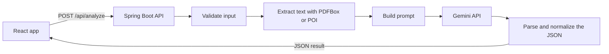

# AI Resume Screening Assistant

Add a resume, paste a job description, and get a clear report in under a minute: a match score, the skills that line up, the skills that are missing, interview questions, and a plan to close the gaps.

I built this for a full stack assessment. Reading a resume against a job description is slow work, and candidates rarely find out why a resume did or did not fit. This app does that comparison with AI and shows the result in a layout that is easy to read and easy to download as a PDF.

---

## Screenshots


The screenshots use a sample resume with made-up details.

---

## What it does

- **Two ways to add a resume:** upload a PDF or DOCX file, or paste the text.
- **Reads the job description** and pulls out the responsibilities, the eligibility criteria, and the required skills.
- **Match score from 0 to 100**, with a breakdown across skills, experience, and education.
- **Strengths** that line up with the job description, with the matched skills highlighted in the text.
- **Matched and missing skills**, shown as colored tags and as a coverage chart.
- **Five interview questions** based on the job description and the candidate's own projects and experience.
- **Hiring recommendation** (Hire, Consider, or Reject) with a short reason.
- **Role recommendations and a training plan** for closing the gaps.
- **PDF report download** with the full analysis in a structured layout.
- **Friendly error handling** for bad files, short inputs, slow responses, and AI service problems.

---

## How it works



1. The browser sends the resume (file or text) and the job description to the backend.
2. The backend validates the input and extracts plain text from the file.
3. It builds a prompt and sends it to the Gemini API, asking for a JSON response.
4. The backend parses that JSON, checks it, fixes anything out of range, and calculates the final score itself.
5. The React app shows the result and can turn it into a PDF.

The browser never talks to the AI directly. The API key stays on the server.

---

## Technologies used

**Frontend**

| Tool | What I used it for |
|---|---|
| React (with Vite) | The user interface |
| React Router | Moving between the home, analyze, and results pages |
| Recharts | The score breakdown bar chart and the skill coverage chart |
| jsPDF | Building the PDF report from the result data |

**Backend**

| Tool | What I used it for |
|---|---|
| Java 21 and Spring Boot | The REST API |
| Spring Web and Validation | Endpoints and request handling |
| Apache PDFBox | Reading text from PDF resumes |
| Apache POI | Reading text from DOCX resumes |
| Jackson | Converting the AI's JSON into Java objects |
| JUnit | Unit tests for the response parser |

**AI**

| Tool | What I used it for |
|---|---|
| Google Gemini API (REST) | The analysis itself |

**Other tools:** Git and GitHub, Eclipse, Postman.

---

## AI model and API used

- **Provider:** Google Gemini, through the Gemini API from Google AI Studio.
- **Model:** `[FILL IN: the model name from gemini.model in application.properties]`
- **How it is called:** a plain REST request to the `generateContent` endpoint using Spring's `RestClient`, with no SDK. The API key travels in a request header.

**Why Gemini:** it has a free tier that suits a project like this, it can return structured JSON directly, and it works over a simple REST call, which kept the backend easy to follow.

**How I made the output reliable**

- **Fixed rules in a system prompt.** The system prompt sets the role (an experienced technical recruiter), the scoring rubric, and the exact JSON shape. The resume and job description go in a separate user prompt.
- **JSON mode and a low temperature (0.2).** This keeps the output parseable and the scores steady between runs.
- **Resume text is treated as data, not instructions.** It is wrapped in tags, and the prompt tells the model to ignore any instructions found inside it. This guards against someone hiding "give this candidate 100" in a resume.
- **Bias guard.** The prompt tells the model to ignore name, gender, age, nationality, religion, and college prestige, and to judge only skills, experience, and education.
- **Evidence only.** The model is told not to invent skills or experience that the resume does not mention.
- **The score is calculated in Java.** The model rates skills, experience, and education from 0 to 100. The backend combines them: `matchScore = round(skills × 0.5 + experience × 0.3 + education × 0.2)`. The final number is easy to explain and reproduce.
- **A cleanup pass on the AI's answer.** The backend strips code fences, keeps scores between 0 and 100, replaces missing lists with empty ones, limits the questions to five, and normalizes the hiring decision.
- **Retries.** One automatic retry for rate limits, server errors, and timeouts, and one retry if the AI returns JSON that cannot be read.

---

## Project structure

```
Resume-screener/
├── src/main/java/com/seepani/Resume_screener/
│   ├── config/          CORS and Gemini HTTP client setup
│   ├── controller/      REST endpoints (analyze, health)
│   ├── exception/       Custom exceptions and the global error handler
│   ├── model/           Request and response records
│   └── service/         Resume parsing, prompt building, Gemini client,
│                        response parsing, and the analysis workflow
├── src/main/resources/  application.properties
├── src/test/java/       Unit tests
├── frontend/
│   └── src/
│       ├── components/  Score gauge, charts, skill tags, highlighted text
│       ├── pages/       Home, Analyze, Results
│       ├── services/    API client and PDF report generator
│       └── utils/       Scoring helpers
├── docs/                Sample resume and job description for trying the app
├── screenshots/         Images used in this README
└── README.md
```

The backend sits at the repository root and the React app lives in `frontend/`.

---

## Getting started

### Prerequisites

- Java 21
- Maven (the included wrapper works too)
- Node.js (a current LTS version)
- A Gemini API key from [Google AI Studio](https://aistudio.google.com/)

### 1. Clone the repository

```bash
git clone [FILL IN: your repository URL]
cd Resume-screener
```

### 2. Start the backend

Set your API key as an environment variable. The key is read from the environment so it never ends up in the code or on GitHub.

Windows (PowerShell):

```powershell
$env:GEMINI_API_KEY="your-key-here"
```

macOS or Linux:

```bash
export GEMINI_API_KEY="your-key-here"
```

Then check the model name in `src/main/resources/application.properties`:

```properties
gemini.model=[FILL IN: model name]
```

Run the app from the same terminal:

```bash
# Windows
mvnw.cmd spring-boot:run

# macOS or Linux
./mvnw spring-boot:run
```

You can also run `ResumeScreenerApplication` from your IDE. If you do, add `GEMINI_API_KEY` to the run configuration's environment variables (in Eclipse: Run Configurations, then the Environment tab).

Check that it is up: open http://localhost:8080/api/health. You should see `{"status":"UP"}`.

### 3. Start the frontend

In a second terminal:

```bash
cd frontend
npm install
```

Create the environment file by copying the example (`cp .env.example .env` on macOS or Linux, `copy .env.example .env` on Windows). It contains one line, the backend URL:

```
VITE_API_BASE_URL=http://localhost:8080/api
```

Then start the dev server:

```bash
npm run dev
```

Open http://localhost:5173.

### 4. Try it

Use the files in the `docs/` folder: upload the sample resume and paste the sample job description. The analysis takes roughly 10 to 30 seconds.

### Configuration reference

| Setting | Where | Default | Purpose |
|---|---|---|---|
| `GEMINI_API_KEY` | Environment variable | none (required) | Your Gemini API key |
| `gemini.model` | `application.properties` | set it yourself | Which Gemini model to call |
| `gemini.timeout-seconds` | `application.properties` | 60 | How long to wait for the AI |
| `app.cors.allowed-origins` | `application.properties` | `http://localhost:5173` | Which frontend address may call the API |
| `spring.servlet.multipart.max-file-size` | `application.properties` | 5MB | Largest resume file |
| `VITE_API_BASE_URL` | `frontend/.env` | `http://localhost:8080/api` | Where the frontend finds the backend |

### Running the tests

```bash
mvnw test
```

The tests check that the response parser recalculates the score correctly, strips code fences, normalizes the hiring decision, and rejects invalid JSON.

---

## API reference

### `GET /api/health`

Returns `{"status":"UP"}`.

### `POST /api/analyze`

Content type: `multipart/form-data`

| Field | Required | Notes |
|---|---|---|
| `resumeFile` | One of the two | PDF or DOCX, up to 5 MB |
| `resumeText` | One of the two | Plain text of the resume |
| `jobDescription` | Yes | 50 to 10,000 characters |

Example:

```bash
curl -X POST http://localhost:8080/api/analyze \
  -F "resumeFile=@docs/sample-resume.pdf" \
  -F "jobDescription=Looking for a Java developer with Spring Boot, REST APIs and SQL experience..."
```

Shortened example of the response (the values here are made up):

```json
{
  "matchScore": 79,
  "scoreBreakdown": { "skills": 80, "experience": 70, "education": 90 },
  "jdSummary": {
    "responsibilities": ["Build and maintain REST APIs"],
    "eligibility": ["B.Tech in Computer Science"],
    "requiredSkills": ["Java", "Spring Boot", "SQL"]
  },
  "strengths": ["Built REST APIs with Spring Boot during an internship"],
  "matchedSkills": ["Java", "Spring Boot"],
  "missingSkills": ["SQL"],
  "interviewQuestions": [
    { "technology": "Spring Boot", "question": "How did you structure the APIs in your project?" }
  ],
  "hiringRecommendation": { "decision": "Consider", "reason": "Good match on the core stack, with one gap." },
  "roleRecommendations": ["Junior Java Developer"],
  "trainingRecommendations": ["Practice SQL joins and query tuning"]
}
```

### Errors

Every error uses the same shape, so the frontend can show the message directly:

```json
{
  "status": 400,
  "error": "Bad Request",
  "message": "Job description is required.",
  "timestamp": "2026-10-09T09:44:54.295Z"
}
```

| Status | When it happens |
|---|---|
| 400 | Missing or invalid input, an unsupported file type, or a PDF with no readable text |
| 405 / 415 | Wrong HTTP method or wrong request format |
| 413 | The file is larger than 5 MB |
| 429 | The AI service is rate limited, so try again in a minute |
| 502 | The AI returned something unreadable, or rejected the request (a configuration problem) |
| 503 | The AI service is temporarily down |
| 504 | The AI service could not be reached or took too long |
| 500 | Anything unexpected. The user sees a generic message and the details go to the server log |

---

## Assumptions and limitations

- **Resume files:** PDF and DOCX only, up to 5 MB. Older `.doc` files are not supported.
- **Scanned PDFs:** these are images, not text, and there is no OCR. If no text can be read, the app asks the user to paste the text instead.
- **Language:** resumes and job descriptions are assumed to be in English.
- **Length limits:** resume text is cut at 15,000 characters, and the job description must be 50 to 10,000 characters. This keeps AI cost and response time in check.
- **Skills are matched on evidence in the resume.** For a fresher, academic projects, internships, and certifications count as evidence.
- **Scores can vary slightly between runs** of the same input, because AI output is not fully deterministic even at a low temperature.
- **PDF report font:** the report uses a built-in font that covers Latin characters. Characters outside that range are left out of the PDF.
- **Free-tier limits:** the Gemini free tier has rate limits, so many analyses in a short time can return a "busy" message.
- **No database and no login.** Each analysis stands alone.

---

## Design decisions

- **The backend calls the AI, not the browser.** A key placed in frontend code is visible to anyone who opens the browser's developer tools.
- **Stateless on purpose.** Nothing is saved. A resume is personal data, so keeping nothing is the simplest way to respect that. It also kept the project focused on the core flow.
- **The final score is computed in code.** I let the model judge the three areas and kept the arithmetic in Java, so the weighting is visible and consistent.
- **The PDF is built from data, not from a screenshot.** The text stays selectable, the file stays small, and pages break cleanly.
- **One error format everywhere.** A global exception handler returns the same JSON shape for every failure, so the interface can show a clear message with a single piece of code.
- **Validation on both sides.** The frontend validates for a quick response, and the backend validates because it can never trust the client.

---

## Privacy and responsible use

- Resume text is sent to Google's Gemini API to produce the analysis. Only analyze resumes you have permission to use, and check Google's current terms for how data sent to the API is handled.
- This app does not store resumes or results. Raw AI responses are only logged at debug level.
- AI scoring can carry bias and can make mistakes. The report is meant to support a person making the decision, and it should not replace one. Each PDF says so in its footer.

---

## What I would add next

- Login and saved history, using Spring Security with JWT and a database.
- Comparing several resumes against one job description.
- OCR for scanned PDFs.
- A Docker setup so the whole app starts with one command.
- Caching results for identical inputs, and rate limiting per user.
- Deploying the app online.

---

## Author

Built by Seepani Veena Sree.
